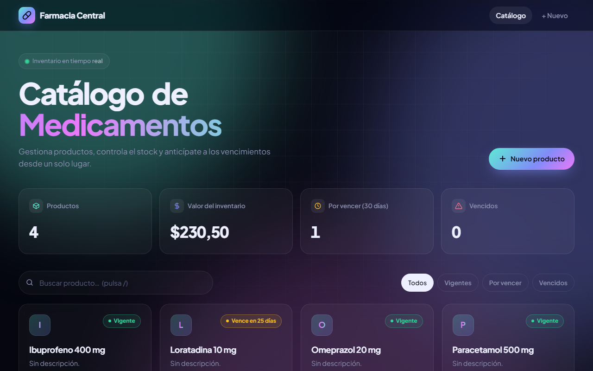

# 💊 Catálogo Farmacia

[](https://github.com/Fernandamv96/CatalogoFarmacia/actions/workflows/ci.yml)
[](https://github.com/Fernandamv96/CatalogoFarmacia/actions/workflows/codeql.yml)


[](LICENSE)

Aplicación Django (CRUD) para gestionar el catálogo de productos de una farmacia: stock, precio y fechas de vencimiento.

**[▶ Ver demo](https://catalogo-farmacia-sigma.vercel.app)**



## ¿Qué problema resuelve?

Reemplaza la planilla del inventario: muestra el valor total del stock, alerta de los productos por vencer (30 días) o vencidos y no permite registrar productos con la fecha de vencimiento ya pasada.

## Stack

Python 3.12 · Django 5.2 · SQLite (local) / PostgreSQL vía `DATABASE_URL` · WhiteNoise · Vercel

## Estructura del proyecto

```
CatalogoFarmacia/
├── core/                  # Configuración del proyecto Django
│   ├── settings.py
│   ├── urls.py
│   ├── wsgi.py            # Punto de entrada en Vercel
│   └── asgi.py
├── farmacia/              # App del catálogo
│   ├── migrations/
│   ├── static/farmacia/   # CSS y JS de la interfaz
│   ├── templates/farmacia/
│   │   ├── catalogo_list.html
│   │   ├── catalogo_form.html
│   │   └── catalogo_confirm_delete.html
│   ├── admin.py
│   ├── apps.py
│   ├── forms.py
│   ├── models.py
│   ├── tests.py
│   ├── urls.py
│   └── views.py
├── templates/
│   └── base.html          # Plantilla base compartida
├── manage.py
├── requirements.txt
├── vercel.json
└── .python-version
```

## Cómo correrlo localmente

```bash
python -m venv venv
venv\Scripts\activate        # Windows  (Linux/Mac: source venv/bin/activate)
pip install -r requirements.txt
python manage.py migrate
python manage.py createsuperuser
python manage.py runserver
python manage.py test       # ejecutar pruebas
```

En local `DEBUG` es `True` por defecto y se usa una clave de desarrollo. **Con `DEBUG=False` la app exige `SECRET_KEY`** (ver `.env.example`).

Lint: `pip install ruff==0.17.0 && ruff check . && ruff format --check .`

## Seguridad

- `SECRET_KEY` obligatoria fuera de desarrollo; cookies `Secure`, HSTS y `Referrer-Policy` en producción.
- CSRF de Django en todos los formularios; ORM sin SQL crudo.
- CI con ruff, tests y `manage.py check --deploy`; CodeQL, Dependabot y gitleaks (pre-commit).

Para reportar vulnerabilidades, mira [SECURITY.md](SECURITY.md).

## Qué aprendí

- El patrón MVT de Django y las vistas genéricas basadas en clases para un CRUD completo.
- A validar reglas de negocio en el formulario (por ejemplo, no aceptar fechas vencidas) y a probarlas.
- A desplegar Django en un entorno serverless (Vercel) y lo que implica su sistema de archivos efímero.
- Que un valor por defecto para `SECRET_KEY` termina usándose en producción si nadie lo configura.

## Licencia

[MIT](LICENSE) © 2026 Fernanda (Fernandamv96)
